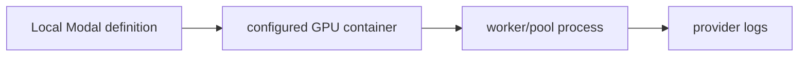

# Serverless GPU Workers

**Experimental Modal definitions for containerized GPU mining workers.**

  [](LICENSE)

[Overview](#overview) · [Quickstart](#quickstart) · [Example](#example) · [Validation](#validation) · [Documentation](#documentation)

## Overview

Experimental Modal GPU worker definitions for containerized mining workloads and operational logging.

**Stack:** Python · Modal · GPU container images · worker/pool integrations

## Explicit workload definitions

| Component | Behavior |
| --- | --- |
| Image | Python definitions describe the runtime/container environment. |
| Worker | GPU and pool-specific configuration selects the workload. |
| Logs | Execution state and logs belong to the configured provider runtime. |

## Processing path



## Quickstart

```console
python -m py_compile modal-pearl/akoya_modal.py modal-pearl/pearlhash_modal.py
```

The commands above install prerequisites or run the specified offline checks. Live collection, cloud operations, messaging and trading are separate operational steps when present.

## Example

**Inspect the workflow**

Compare the two Python definitions offline to identify image construction, worker arguments and pool configuration. Installing Modal, authenticating and invoking a deployment are separate operational steps; the syntax command does not import the SDK or allocate a GPU.

## Configuration and storage

The source uses the Modal Python SDK and GPU container images. Logs/provider state live in that runtime; no local database or reproducible hashrate dataset is bundled.

## Repository guide

| Location | Responsibility |
| --- | --- |
| [modal-pearl/akoya_modal.py](modal-pearl/akoya_modal.py) | Akoya workload definition |
| [modal-pearl/pearlhash_modal.py](modal-pearl/pearlhash_modal.py) | Pearl workload definition |

## Validation

The quickstart lists the declared checks. No passing CI or coverage claim is implied by the technology badges.

## Scope and operational boundaries

This is experimental infrastructure code. modal run/deploy can start billable workloads. Historical hashrate/cost claims are not fresh measurements, and no dedicated offline behavior suite is bundled.

## Documentation

- The repository guide above links directly to the implementation and configuration files.

## License and attribution

Project-authored source code is licensed under the [MIT License](LICENSE). Third-party components and datasets retain their respective rights and licenses.
